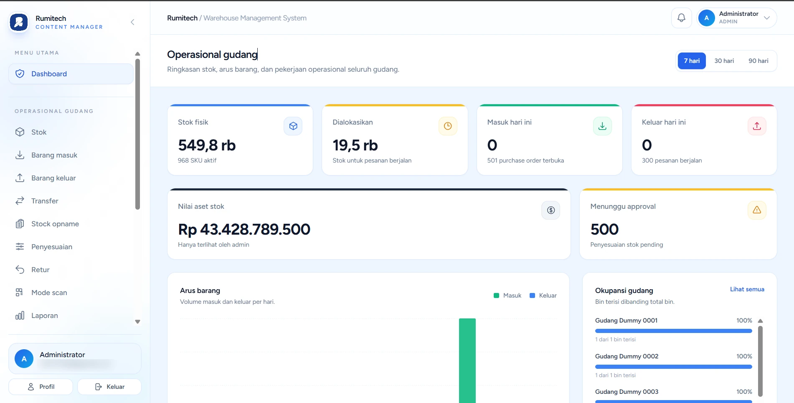
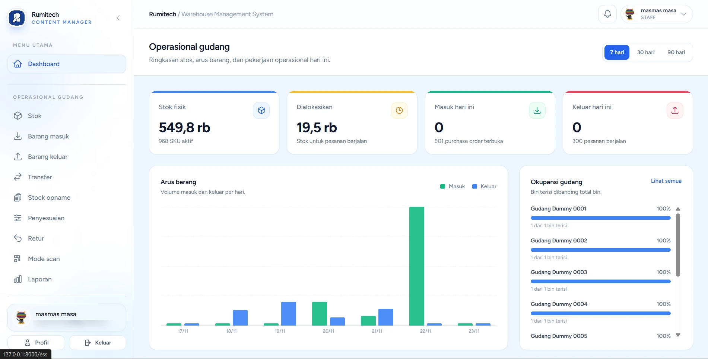

<p align="center">
    
</p>

<h1 align="center">Rumitech</h1>

<p align="center">
    Aplikasi WMS berbasis Laravel untuk mengelola stok dan operasional gudang.
</p>

<p align="center">
    
    
    
    
    
    
</p>

## Tentang

Rumitech adalah aplikasi **Warehouse Management System (WMS)** berbasis Laravel untuk mencatat barang masuk, barang keluar, perpindahan stok, dan seluruh aktivitas inventori dalam satu tempat. Aplikasi ini menyediakan dua portal:

- **Admin** (`/`) untuk pengelolaan master data, persetujuan, laporan, dan audit.
- **ESS / Staf** (`/ess`) untuk operasional gudang sehari-hari.

## Tangkapan Layar

### Halaman Login

<p align="center">
    
</p>

### Dashboard Admin

<p align="center">
    
</p>

### Dashboard Staf (ESS)

<p align="center">
    
</p>

> Data pada tangkapan layar adalah data contoh.

## Fitur Utama

- **Dashboard** — ringkasan stok fisik, stok teralokasi, arus barang, nilai aset, okupansi gudang, dan approval yang menunggu.
- **Inventori** — kartu stok, stok per bin, lokasi, dan riwayat pergerakan barang.
- **Barang masuk** — purchase order, penerimaan, staging, dan put-away.
- **Barang keluar** — sales order, reservasi, picking FIFO/FEFO, packing, dan shipping.
- **Transfer stok** — perpindahan antar bin maupun antar gudang.
- **Stock opname** — blind count dan penyelesaian selisih stok.
- **Penyesuaian stok** — pengajuan dari staf dan persetujuan oleh admin.
- **Retur** — retur barang beserta disposisinya.
- **Scan & label** — mode scan barcode dan cetak label stok/lot.
- **Laporan** — kartu stok, aging stok, kapasitas gudang, dan ledger.
- **Master data** — produk, gudang, bin/lokasi, pemasok, dan ekspedisi.
- **Pengguna & audit** — manajemen pengguna dengan role admin/staf dan log aktivitas.
- **Notifikasi & pengumuman** — informasi internal untuk seluruh pengguna.
- **Mode terang/gelap** — tema Terang, Gelap, atau mengikuti Sistem pada halaman aplikasi.

## Peran Pengguna

| Peran | Portal | Hak Akses |
| --- | --- | --- |
| **Admin** | `/` | Akses penuh ke master data, manajemen pengguna, persetujuan, laporan lengkap, dan audit aktivitas. |
| **Staf (ESS)** | `/ess` | Operasional gudang: blind count, pengajuan penyesuaian, retur, scan, dan melihat kartu stok. |

## Teknologi

| Komponen | Keterangan |
| --- | --- |
| Framework | Laravel 13 |
| Bahasa | PHP 8.3+ |
| Database | MySQL 8 / MariaDB (disarankan) atau SQLite |
| Tampilan | Blade, Tailwind CSS 3, Alpine.js 3 |
| Build | Vite 8 |
| Login Google | Laravel Socialite (opsional) |

## Kebutuhan Sistem

- **PHP 8.3+** dengan ekstensi `ctype`, `curl`, `dom`, `fileinfo`, `filter`, `hash`, `mbstring`, `openssl`, `pcre`, `pdo`, `session`, `tokenizer`, `xml`, serta `pdo_mysql` (MySQL) atau `pdo_sqlite` (SQLite).
- **Composer 2**
- **Node.js 20.19+** (atau 22.12+) dan **npm**
- **MySQL 8+/MariaDB 10.6+** atau **SQLite**
- Web server (Apache/Nginx) untuk produksi; `php artisan serve` cukup untuk pengembangan lokal.

## Instalasi

### 1. Clone repositori

```bash
git clone https://github.com/Masmas99/cms.git
cd cms
```

### 2. Instal dependensi PHP

```bash
composer install
```

### 3. Konfigurasi environment

```bash
cp .env.example .env
php artisan key:generate
```

Di Windows PowerShell:

```powershell
Copy-Item .env.example .env
php artisan key:generate
```

### 4. Siapkan database

**Opsi A — MySQL (disarankan)**

Buat database terlebih dahulu:

```sql
CREATE DATABASE rumitech CHARACTER SET utf8mb4 COLLATE utf8mb4_unicode_ci;
```

Lalu sesuaikan bagian database di `.env`:

```dotenv
DB_CONNECTION=mysql
DB_HOST=127.0.0.1
DB_PORT=3306
DB_DATABASE=rumitech
DB_USERNAME=root
DB_PASSWORD=
```

**Opsi B — SQLite**

```bash
touch database/database.sqlite
```

Di Windows PowerShell:

```powershell
New-Item database\database.sqlite
```

Lalu ubah `.env`:

```dotenv
DB_CONNECTION=sqlite
```

### 5. Migrasi dan akun admin

Isi akun admin terlebih dahulu di `.env`:

```dotenv
ADMIN_NAME="Administrator"
ADMIN_EMAIL=admin@example.com
ADMIN_PASSWORD=ganti-dengan-password-kuat
```

Jalankan migrasi dan buat akun admin:

```bash
php artisan migrate
php artisan db:seed --class=AdminUserSeeder
```

> `AdminUserSeeder` melewati pembuatan akun jika `ADMIN_EMAIL` atau `ADMIN_PASSWORD` masih kosong.

> Registrasi pengguna baru memerlukan verifikasi email. Isi konfigurasi `MAIL_*` di `.env` agar email verifikasi dan reset kata sandi dapat terkirim.

### 6. Tautkan storage

```bash
php artisan storage:link
```

### 7. Build frontend

```bash
npm install
npm run build
```

### 8. Jalankan aplikasi

```bash
php artisan serve
```

Buka `http://localhost:8000`, lalu login di `http://localhost:8000/login`. Admin diarahkan ke `/`, staf ke `/ess`.

### Ringkasan perintah

```bash
git clone https://github.com/Masmas99/cms.git
cd cms

composer install
cp .env.example .env
php artisan key:generate

# Sesuaikan .env (database, ADMIN_*, dan lainnya)

php artisan migrate
php artisan db:seed --class=AdminUserSeeder
php artisan storage:link
npm install
npm run build
php artisan serve
```

## Data Demo (Opsional)

Untuk mencoba aplikasi dengan data contoh:

```bash
php artisan migrate:fresh --seed
```

Perintah tersebut akan membuat:

- Akun admin sesuai `ADMIN_EMAIL` dan `ADMIN_PASSWORD` di `.env`.
- 1.000 pengguna dummy (`dummy1@example.com` sampai `dummy1000@example.com`, password `password`).
- Data gudang, produk, stok, transaksi, dan pengumuman contoh.

> **Perhatian:** `migrate:fresh` menghapus seluruh tabel dan data yang ada. Jangan dijalankan pada database produksi.

## Login dengan Google (Opsional)

1. Buat OAuth Client ID bertipe **Web application** di [Google Cloud Console](https://console.cloud.google.com/apis/credentials).
2. Tambahkan **Authorized redirect URI**: `http://localhost:8000/auth/google/callback` (sesuaikan dengan `APP_URL`).
3. Isi `.env`:

```dotenv
GOOGLE_CLIENT_ID=isi-client-id
GOOGLE_CLIENT_SECRET=isi-client-secret
GOOGLE_REDIRECT_URI=http://localhost:8000/auth/google/callback
```

Jika `GOOGLE_CLIENT_ID` dan `GOOGLE_CLIENT_SECRET` kosong, tombol login Google tetap tampil tetapi akan menampilkan pesan bahwa login Google belum dikonfigurasi.

## Pengembangan

Jalankan server Laravel dan Vite sekaligus:

```bash
composer run dev
```

Atau jalankan terpisah:

```bash
php artisan serve
npm run dev
```

Jika perubahan frontend tidak muncul atau muncul error **"Unable to locate file in Vite manifest"**, jalankan `npm run build` (atau pastikan `npm run dev` sedang berjalan). Setelah mengubah `.env`, jalankan `php artisan config:clear`.

## Pengujian

```bash
php artisan test
```

## Deployment (Produksi)

```bash
composer install --no-dev --optimize-autoloader
npm ci
npm run build

php artisan migrate --force
php artisan storage:link
php artisan optimize
```

- Set `APP_ENV=production` dan `APP_DEBUG=false`.
- Arahkan document root web server ke folder `public/`.
- Jalankan worker antrean: `php artisan queue:work` (supervisor/systemd).
- Tambahkan cron untuk scheduler: `* * * * * cd /path/ke/cms && php artisan schedule:run >> /dev/null 2>&1`.
- Gunakan HTTPS dan backup database secara rutin.

## Struktur Direktori

| Path | Keterangan |
| --- | --- |
| `app/Http/Controllers` | Controller admin, ESS, dan autentikasi. |
| `app/Models` | Model Eloquent (produk, stok, pesanan, pengguna, dll.). |
| `app/Services` | Logika inventori dan layanan pendukung. |
| `resources/views/pages/admin` | Halaman portal admin. |
| `resources/views/pages/ess` | Halaman portal staf. |
| `resources/js` | Alpine.js, tema, dan interaksi frontend. |
| `routes/web.php` | Routing aplikasi. |
| `database/seeders` | Seeder admin, data demo, dan pengumuman. |
| `tests` | Unit dan feature test. |
| `public/images` | Logo dan tangkapan layar. |

## Keamanan

- File `.env` tidak pernah ikut ter-commit. Gunakan `.env.example` sebagai referensi dan isi kredensial hanya di server.
- Ganti `ADMIN_PASSWORD` dengan kata sandi yang kuat dan unik.
- Jangan aktifkan `APP_DEBUG=true` di produksi.
- Simpan `GOOGLE_CLIENT_SECRET`, kredensial database, dan kunci SMTP sebagai rahasia.
- Gunakan HTTPS di produksi dan backup database secara berkala.
- Jika registrasi publik tidak diperlukan, batasi akses halaman `/register` sesuai kebutuhan organisasi.

## Lisensi

Proyek ini dirilis di bawah [MIT License](LICENSE).
